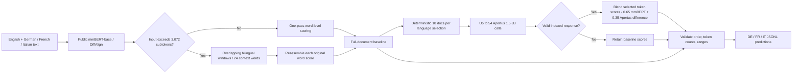

# CLAUSESHIFT — Method visualization

Hack Apertus 2026 · Track 2A · SwissGov-RSD · H1-HYBRID V1.15.2

**Bounded external contribution:** 18 selected documents per language, up to 12 tokens on each side within 32-word windows, at most 54 calls. Invalid responses fail closed without retry.

**Measured development evidence:** public mmBERT all-DEV macro Spearman = **0.129185**. On a 54-document *selected* DEV ablation, H1 − mmBERT = **+0.001000** macro, with French regression. These are not final test results.

**Final structural validation:** 224 EN–DE + 224 EN–FR + 224 EN–IT = **672/672 records** validated by the offline Docker validator. This measures formatting and coverage, not hidden-set accuracy.

For full reproducibility, limitations and disclosure of the post-first-access completeness fix, consult [the technical report](../technical_report.md).
